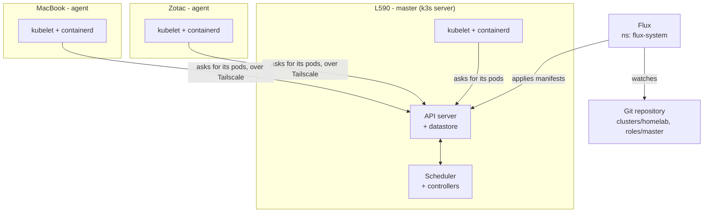

# ARCH1 Base: k3s cluster on physical nodes

**Status:** done | **Date:** 2026-11-11 | **Nodes:** [NODES1-base.md](NODES1-base.md) | **Network:** [N1-tailscale.md](N1-tailscale.md)

---

## Goal

Run a small k3s cluster on machines I already own: one control plane that stores and manages pods, and two agents that run them.

## Architecture

The master node (L590) runs the main k3s server. Zotac and the MacBook run the k3s agent: they join the master, follow its rules and run the pods it assigns them.

The nodes talk to each other over Tailscale (see [N1](N1-tailscale.md)), so every k3s address below is a `100.x.x.x` Tailscale IP.

Exposing pods to the outside (Cloudflare Tunnel) is a separate topic and lives in its own doc (IN-1), because it is about how I expose pods, not how the cluster is set up.

Hardware of each node: [NODES1-base.md](NODES1-base.md).

## What the system does

This repository describes and configures a small home lab. The physical
machines form one k3s cluster: L590 runs the control plane, while Zotac and
the MacBook join as worker nodes. Tailscale provides the private network the
nodes use to reach one another.

Flux watches this repository and applies the Kubernetes configuration under
`clusters/homelab/` and `roles/master/`. Kubernetes then runs the application
workloads as pods, gives them stable in-cluster Services, and attaches
persistent storage where configured. The app manifests are grouped under
`roles/master/apps/`; that path contains the resources that create and manage
pods rather than a separate directory of individual pod definitions.

For services configured for external access, Cloudflare sends requests through
the outbound Tunnel to Traefik. Traefik uses each app's Ingress hostname to
route the request to its Kubernetes Service. The cluster and GitOps flow are
described here; the detailed network and ingress paths are in [N1 Tailscale](../network/N1-tailscale.md)
and [IN1 Cloudflare Tunnel](../ingress/IN1-cloudflare.md).

## How it works

### The idea in one sentence

I describe what I want to run ("keep this app running"), and the cluster decides which machine runs it and keeps it running there.

### What k3s is

k3s is a lightweight Kubernetes: the same API and concepts, packed into one small program, so it runs fine on old laptops and a mini PC. Kubernetes is a system that runs containers across several machines and keeps them in the state I asked for.

### The two roles

| Role                   | Node(s)        | What it does                                                                           |
| ---------------------- | -------------- | -------------------------------------------------------------------------------------- |
| Control plane (server) | L590           | Stores the desired state, decides where pods run, watches for problems and fixes them. |
| Agent (worker)         | Zotac, MacBook | Runs the pods it is given and reports their status back to the master.                 |

What is inside each role:

- **API server:** the front door of the cluster. Every tool (`kubectl`, Flux, the agents) talks to it. Nothing talks to the datastore directly.
- **Datastore:** where the cluster's state is saved (the list of pods, Services, Secrets, and so on). In a single-server k3s it is an embedded SQLite database on the master. This is why a lost master means a lost cluster state, and why backups matter.
- **Scheduler:** picks a node for every new pod, based on free CPU and RAM and any rules on the pod.
- **Controllers:** loops that compare "what I asked for" with "what exists" and fix the difference (start a missing pod, restart a crashed one).
- **kubelet + containerd (on every node, the master included):** kubelet receives the pods assigned to its node and tells containerd to pull the image and start the container. In k3s the master also runs workloads, which is why some pods (for example Grafana and Prometheus) run on L590 as well.

### What happens when I deploy something

1. I commit a manifest (Deployment, Service, Ingress) to the repo.
2. Flux, which runs inside the cluster (namespace `flux-system`), sees the new commit and applies it to the API server.
3. The API server saves it in the datastore. The desired state now says "3 pods of app X should exist".
4. The scheduler assigns each pod to a node.
5. The kubelet on that node sees its new pod, pulls the image and starts the container.
6. Controllers keep watching. If a pod crashes it is restarted. If I change the manifest, Flux applies it again and the pods are replaced.

### How the nodes join

The agent starts with the master's address and the join token, connects to the API server on port 6443 (over Tailscale), registers itself as a node and starts asking the API server for its pods. This is why the install command on the agents needs `K3S_URL` and `K3S_TOKEN`, and why the token must never be committed.

### How pods talk to each other

- **Pod network:** k3s uses Flannel. Every pod gets its own IP (the `10.42.x.x` range), and Flannel carries pod traffic between nodes. With `--flannel-iface tailscale0` that traffic goes over Tailscale, so a pod on Zotac can reach a pod on L590 through the private network.
- **Services:** a pod IP changes whenever the pod is replaced, so each app gets a Service with a stable address inside the cluster.
- **Cluster DNS:** CoreDNS lets pods use names like `traefik.kube-system.svc.cluster.local` instead of IPs.
- **Traefik:** the bundled ingress controller that receives traffic from outside and routes it to the right Service (see [IN1 Cloudflare Tunnel](../ingress/IN1-cloudflare.md)).

### What happens when something breaks

| Event                | What the cluster does                                                                                                                                                                        |
| -------------------- | -------------------------------------------------------------------------------------------------------------------------------------------------------------------------------------------- |
| A container crashes  | kubelet restarts it on the same node.                                                                                                                                                        |
| A node goes down     | After a timeout (default about 5 minutes) its pods are marked lost and Deployments recreate them on other nodes. Pods that depend on storage tied to that node cannot move until it is back. |
| The master goes down | Running pods keep running, but nothing new can be scheduled, nothing can be changed, and failed pods are not replaced.                                                                       |

### Diagram: how the cluster works



Legend: arrows point from the component that starts the request to the component it asks. Agents always call the master, never the other way round.

## Decision

One k3s server (master) and two k3s agents.

## Why

I am new to k3s/Kubernetes, so I took the path of least resistance. Plain Docker, which I used before for homelabs, would have been easier, but I chose k3s to learn it.

I accepted that nodes will sometimes shut down and my uptime will be bad. For my own use and a few family members that is fine, as long as I have backups and a fallback policy. TODO: write that doc.

## Pros and cons

### Pros

- Easy to set up: the control plane makes the rules and the agents follow them.
- No extra services needed to connect the nodes to each other.

### Cons

- No fallback out of the box: if a node goes down, its pods go down with it.
- If the master is down, the whole cluster is down.

## Alternatives

| Option                                                   | Why not (at the time)                                                                                               |
| -------------------------------------------------------- | ------------------------------------------------------------------------------------------------------------------- |
| 3 servers with embedded etcd (HA, any one node can fail) | More setup, and it needs stable, low-latency links between nodes (I run over Wi-Fi and Tailscale). See improvements |
| 3 separate single-node k3s clusters                      | A nightmare to set up and manage by hand                                                                            |
| Plain Docker / Docker Compose                            | Easier, but I want to learn k3s                                                                                     |

## Steps taken

1. Make sure Tailscale is up on every node (see N1) and note each node's `100.x.x.x` IP. The `tailscale0` interface must exist before k3s starts.

2. Install the k3s server on the master (L590):

   ```bash
   V=$(curl -sIL -o /dev/null -w '%{url_effective}' https://github.com/k3s-io/k3s/releases/latest | sed 's|.*/tag/||; s|%2B|+|')
   echo "$V"

   curl -sfL https://get.k3s.io | sudo env INSTALL_K3S_VERSION="$V" sh -s - server \
     --node-name l590 \
     --node-ip MASTER_TS_IP \
     --advertise-address MASTER_TS_IP \
     --tls-san MASTER_TS_IP \
     --tls-san l590 \
     --flannel-iface tailscale0
   ```

3. Read the join token on the master (a secret, never commit it):

   ```bash
   sudo cat /var/lib/rancher/k3s/server/node-token
   ```

4. Install the k3s agent on each other node (Zotac, MacBook), with the same k3s version as the master:

   ```bash
   curl -sfL https://get.k3s.io | sudo env \
     INSTALL_K3S_VERSION="$V" \
     K3S_URL=https://MASTER_TS_IP:6443 \
     K3S_TOKEN=<token, do not commit> \
     sh -s - agent --node-name zotac --node-ip THIS_NODES_TS_IP --flannel-iface tailscale0
   ```

   For the MacBook use `--node-name mac`. Set `V` to the same version there (copy it from the master's output).

5. Verify on the master:

   ```bash
   sudo k3s kubectl get nodes -o wide
   ```

## Result

A working cluster with one control plane that stores and manages pods, running over Tailscale.

## Improvements

- Write a backup policy and a fallback policy, and make the nodes less dependent on each other.
- Make sure the control plane stays up and can recover by itself.
- Try HA with 3 servers (embedded etcd) so the master is no longer a single point of failure. Start with the k3s docs page "High Availability Embedded etcd".

## Lessons

- What k3s is.
- What the master and agents are, why they exist and what each does.
