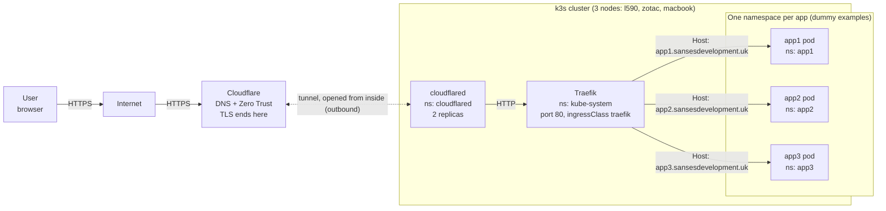
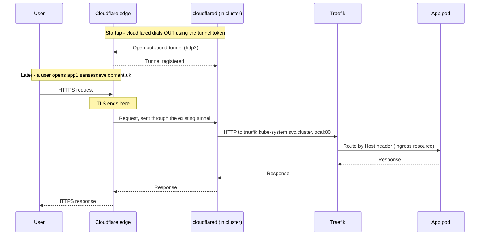

# Cloudflare Tunnel ingress

**Status:** done | **Date:** 2026-11-11 | **Nodes:** [NODES1-base.md](NODES1-base.md)

---

## Goal

Make pods accessible from the web without opening any port on the home router.

## What I chose

Cloudflare Tunnel with a single entry point inside the cluster.

- All requests to my apps go through a Cloudflare Zero Trust tunnel on my domain `sansesdevelopment.uk` (bought earlier for my backend projects).
- `cloudflared` (2 replicas) forwards everything to Traefik, the k3s ingress controller.
- Traefik picks the target pod by **hostname** (`Host` header), for example `app1.sansesdevelopment.uk`. One subdomain per app, one namespace per app.

## Why

- The domain was already in Cloudflare and I use it for my Docker containers.
- One of the easiest and most popular options.

## Pros

- Easy setup, familiar UI.
- No inbound ports are open on my router. The tunnel is opened from inside the cluster (outbound only).
- Extra protection from Cloudflare (DDoS filtering, optional Access policies).

## Cons

- Cloudflare dependency: if Cloudflare is down, nothing is reachable from outside.
- The tunnel token Secret is created by hand and is not backed up anywhere.
- TLS ends at Cloudflare. Inside the cluster the traffic is plain HTTP.

## Alternatives

- Port forwarding on the router: simpler, but it exposes my home server directly to the internet.

---

## How it works

### The idea in one sentence

Instead of letting the internet connect _to_ my server, my server connects _out_ to Cloudflare and keeps that connection open. Cloudflare sends visitors' requests back through it.

### The pieces and their jobs

| Piece         | Job                                                                                                                       |
| ------------- | ------------------------------------------------------------------------------------------------------------------------- |
| Cloudflare    | Public front door. Holds the DNS records, terminates TLS, knows which hostname goes to which tunnel.                      |
| Tunnel        | A named connection (`homelab`) registered in Cloudflare. The token identifies it.                                         |
| `cloudflared` | A small program in the cluster. Uses the token to open the outbound tunnel, then passes requests on to Traefik.           |
| Traefik       | The cluster's ingress controller (bundled with k3s). Reads `Ingress` objects and decides which service gets each request. |
| `Ingress`     | A per-app rule: "requests for host X go to service Y". Lives in the app's namespace.                                      |
| Service / pod | The app itself. A Service gives the pods a stable name and address inside the cluster.                                    |

### One-time setup (what happens when I configure it)

1. I create the tunnel in the Cloudflare dashboard. Cloudflare gives me a token.
2. I add a Public Hostname rule: hostname `app1.sansesdevelopment.uk` goes to `http://traefik.kube-system.svc.cluster.local:80`. Cloudflare creates a DNS record for that hostname that points to the tunnel (the record is proxied, so visitors see Cloudflare's IPs, never mine).
3. I store the token as a Secret and deploy `cloudflared` with it.
4. On start, each `cloudflared` pod connects **outbound** to Cloudflare and registers itself for the tunnel. Both replicas register for the same tunnel, and Cloudflare spreads requests between them.

No router port is opened at any point.

### What happens on a request

1. A user opens `app1.sansesdevelopment.uk`. DNS answers with Cloudflare's address, so the browser connects to Cloudflare.
2. Cloudflare terminates TLS (the HTTPS ends here) and checks its Public Hostname rules to find the tunnel for this hostname.
3. Cloudflare sends the request down the already-open tunnel to one of the `cloudflared` pods.
4. `cloudflared` forwards it as plain HTTP to `traefik.kube-system.svc.cluster.local:80`. This name only resolves inside the cluster (cluster DNS), and the original hostname is kept in the `Host` header.
5. Traefik compares the `Host` header with its `Ingress` rules and picks the matching one. Traefik keeps these rules up to date by watching the Kubernetes API, so no restart is needed when an app is added.
6. Traefik sends the request to the app's Service, which hands it to one of the app's healthy pods.
7. The response goes back the same way: pod, Traefik, `cloudflared`, tunnel, Cloudflare, user. Cloudflare encrypts it again for the browser.

### Why the traffic is only HTTP inside the cluster

TLS ends at Cloudflare. The hop from `cloudflared` to Traefik stays on the cluster network and the tunnel itself is already encrypted between the cluster and Cloudflare, so there is no certificate to manage in Traefik or in the apps.

### Adding a new app later

1. Deploy the app (namespace, Deployment, Service).
2. Add an `Ingress` with `ingressClassName: traefik` and the new hostname.
3. Add the hostname in Cloudflare (Public Hostname pointing to the Traefik URL), unless a wildcard rule already covers it.

Nothing changes in `cloudflared` or Traefik itself.

---

## Diagram 1: request path

All app names below are dummies to show the logic. Real apps live in their own docs (one doc per pod).



Legend: solid arrow = request direction, dashed double arrow = the tunnel connection (opened by `cloudflared`, not by Cloudflare).

## Diagram 2: who opens the connection



---

## Where each piece is configured

| Piece         | What                                                             | Where                                                          |
| ------------- | ---------------------------------------------------------------- | -------------------------------------------------------------- |
| Cloudflare    | Tunnel + Public Hostname rules (hostname to Traefik service URL) | Cloudflare dashboard, Zero Trust, Networks, Tunnels            |
| `cloudflared` | Deployment (2 replicas, soft anti-affinity)                      | `roles/master/ingress/cloudflared.yaml`                        |
| Tunnel token  | Secret `tunnel-token` in namespace `cloudflared`                 | Created by hand with `kubectl create secret` (not in the repo) |
| Traefik       | k3s bundled ingress controller, default config                   | Nothing in the repo (no HelmRelease, chart or values file)     |
| App routing   | `Ingress` with `ingressClassName: traefik`                       | Per app, e.g. `roles/master/apps/<app>/ingress.yaml`           |
| Setup steps   | How to create the tunnel and deploy `cloudflared`                | `docs/cloudflare_deploy.md`                                    |

### Setup summary

1. Dashboard: Zero Trust, Networks, Tunnels, create a tunnel (type Cloudflared), copy only the token.
2. Public Hostname: hostname `app.yourdomain`, service type HTTP, URL `traefik.kube-system.svc.cluster.local:80`. Cloudflare creates the DNS record.
3. On the master:

```bash
sudo k3s kubectl create namespace cloudflared
sudo k3s kubectl -n cloudflared create secret generic tunnel-token \
  --from-literal=token=PASTE_TOKEN_HERE
```

4. Apply `roles/master/ingress/cloudflared.yaml`.

---

## Failure points

| If this fails                  | What happens                                                                                               |
| ------------------------------ | ---------------------------------------------------------------------------------------------------------- |
| Cloudflare                     | No access from outside. Inside the LAN/cluster everything still works.                                     |
| Both `cloudflared` pods down   | Tunnel closes, no external access. Apps keep running.                                                      |
| Traefik down                   | Every hostname fails at once (single entry point).                                                         |
| Tunnel token lost              | Tunnel has to be recreated, token regenerated, Secret recreated by hand.                                   |
| Both replicas on the same node | That node going down kills the tunnel. Anti-affinity is only a preference (soft), so it is not guaranteed. |

---

## Improvements

Traefik is the k3s default with no custom configuration. Possible next steps, in order of value:

1. **Back up the tunnel token.** Keep it outside the cluster (password manager) and, since the repo is GitOps-style, consider an encrypted Secret (SOPS or Sealed Secrets) so it can be restored from git.
2. **Guarantee replica spread.** Switch the soft anti-affinity to `topologySpreadConstraints` (or a required rule) so the 2 `cloudflared` pods never share a node.
3. **Add health checks to `cloudflared`.** Enable its metrics endpoint and add liveness/readiness probes, so a stuck tunnel gets restarted.
4. **Manage Traefik explicitly.** Use a k3s `HelmChartConfig` for the bundled Traefik so its settings (replicas, resources, access logs) live in the repo instead of in defaults.
5. **Check Traefik replicas.** The k3s default is a single replica. Run 2 if the single entry point matters.
6. **Protect private apps with Cloudflare Access.** Put admin tools (Grafana, code-server, ArgoCD) behind a Zero Trust Access policy.
7. **Wildcard hostname.** A wildcard Public Hostname (`*.sansesdevelopment.uk` to Traefik) means a new app only needs an `Ingress`, with no dashboard change. Verify wildcard DNS behaviour first.
8. **Pin the image by digest** instead of only a tag, once the version is settled.
9. **Document the fallback.** Decide what happens when Cloudflare is down (accept it, or add a second path such as a VPN).
