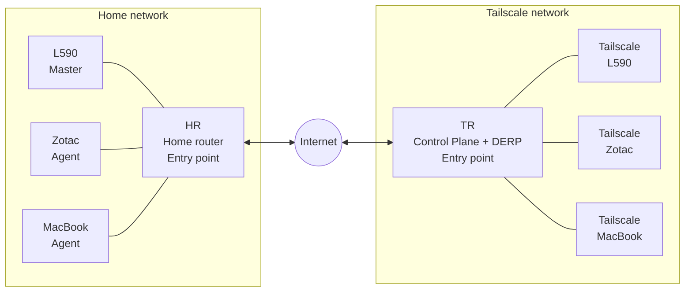

# N1: Tailscale mesh for the cluster

**Status:** done | **Date:** 2026-11-11 | **Next phase:** [N2 Wired LAN](N2-lan.md)

---

## Goal

Connect the cluster nodes to each other over a private network, so the master node can reach its agents without depending on my ISP router configuration.

## Starting point

3 physical nodes:

| Node    | Role                   |
| ------- | ---------------------- |
| L590    | master (control plane) |
| Zotac   | agent                  |
| MacBook | agent                  |

Full specs: [nodes.md](nodes.md)

## Diagram



## Decision

Use Tailscale to connect the master node with the agents.

## Why

My provider does not give me full control of the network, so I cannot assign static IPs to my nodes. Without stable addresses, the nodes cannot reliably find each other without workarounds (re-checking addresses and fixing deployments after every change).
Tailscale gives each node a stable address regardless of what the router does.

## Alternatives

| Option                                             | Why not (at the time)                              |
| -------------------------------------------------- | -------------------------------------------------- |
| Small cheap switch + static IPs                    | Costs money; chosen later as phase [N2](N2-lan.md) |
| Change the provider                                | Too big and expensive for a lab                    |
| Another third-party overlay (for example ZeroTier) | Same trade-offs as Tailscale, less familiar        |

## Pros and cons

### Pros

- Not dependent on my own hardware
- Free tier with enough IPs for my nodes
- Ready-made VPN: I can reach the whole lab from anywhere

### Cons

- **Security:** every node is a door into the network. An attacker needs access to one device, but that is still many doors.
- **Latency:** traffic between nodes goes over Wi-Fi and, when no direct path exists, through a relay on the internet.
  _(to verify: run `tailscale ping <node>` and check whether it says `direct` or `via DERP`)_
- **Dependency on a third party:** if Tailscale or my internet connection is down, the cluster cannot talk to itself.

## Steps taken

1. Create a Tailscale profile on each node (same Tailscale account).
2. Read the Tailscale IP of each node.
3. Use those IPs in my deployments.

```bash
sudo apt install tailscale
sudo tailscale up
tailscale ip -4
```

| Node    | Tailscale IP |
| ------- | ------------ |
| L590    | `100.x.x.x`  |
| Zotac   | `100.x.x.x`  |
| MacBook | `100.x.x.x`  |

## How I verified

```bash
ping <tailscale-ip>      # is the node up, and can I reach it?
tailscale status         # which peers are online
```

## Rollback

Not fully defined yet (known gap).
Plan: set up a switch (it only needs to connect to the router, no external address needed) and keep Tailscale as the fallback in case the switch fails. This is phase [N2](N2-lan.md).

## Problems hit

- **Latency:** noticed, considered and accepted for a lab ("a student can wait for an answer").
- **Overnight outage (Nov 9-10, 2026):** server was unreachable through Tailscale for a night. No reboot happened; the Wi-Fi/router connection is the suspected cause, not yet proven. Details: [postmortem](../postmortems/2026-11-10-node-offline.md).

## Result

A working cluster on a private network that behaves like a local one, reachable from anywhere. Works, but depends on Wi-Fi and the internet, which led to N2.

## Lessons

- Fill in after N2: what did Tailscale solve, what did it only hide?
