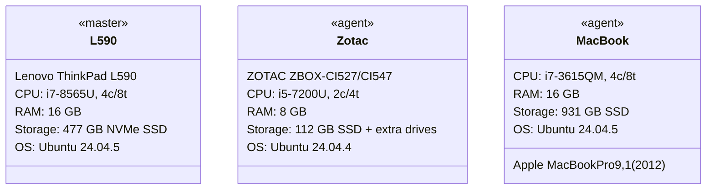

# NODES1 Base: physical nodes

**Status:** done | **Date:** 2026-11-11 | **Architecture:** [ARCH1-base.md](ARCH1-base.md)

---

## Goal

Describe the physical machines in the cluster: what they are and what they can do. How they are connected and what runs on them is in the architecture docs, not here.

## Nodes

| Node                                             | Role                | Hardware                         | CPU              | RAM   | Storage                                           | OS             |
| ------------------------------------------------ | ------------------- | -------------------------------- | ---------------- | ----- | ------------------------------------------------- | -------------- |
| L590 (hostname `master-laptop`, k3s name `l590`) | master (k3s server) | Lenovo ThinkPad L590             | i7-8565U, 4c/8t  | 16 GB | 477 GB NVMe SSD                                   | Ubuntu 24.04.5 |
| Zotac                                            | agent               | ZOTAC ZBOX-CI527/CI547 (mini PC) | i5-7200U, 2c/4t  | 8 GB  | 112 GB SSD + extra drives (931 GB, 115 GB, 29 GB) | Ubuntu 24.04.4 |
| MacBook (`mac`)                                  | agent               | Apple MacBookPro9,1 (2012)       | i7-3615QM, 4c/8t | 16 GB | 931 GB SSD                                        | Ubuntu 24.04.5 |

TODO: note what the Zotac's extra drives are (USB disks, flash, etc.).

Note: `hostnamectl` reports the Zotac as a "laptop". That is a detection quirk, it is a mini PC.

## Diagram

Three standalone descriptions, no links between them.



## How the specs were collected

```bash
hostnamectl
lscpu | grep -E 'Model name|^CPU\(s\)'
free -h
lsblk -d -o NAME,SIZE,TYPE,ROTA
```

`ROTA` is `1` for HDD and `0` for SSD. USB drives often report `1` even when they are SSDs or flash.
